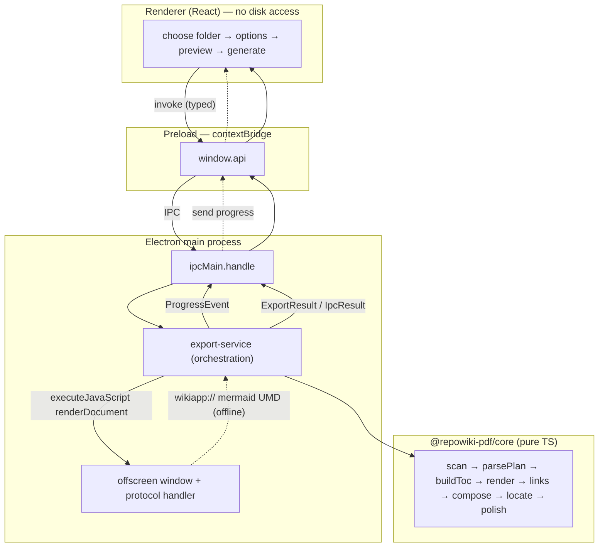

# Architecture

RepoWiki→PDF is a TypeScript **npm-workspaces monorepo** split into three packages. The
conversion logic lives in a **pure, Electron-free core**; the Electron app is a thin shell
that drives that core and does the actual printing.

## Packages

| Package | Name | Responsibility | Electron? |
|---------|------|----------------|-----------|
| `packages/core` | `@repowiki-pdf/core` | Scanning, plan parsing, TOC building, Markdown→HTML, link/image rewriting, document composition, PDF section location + bookmarks. | **Never** imports Electron. |
| `packages/theme` | `@repowiki-pdf/theme` | GitHub-style screen CSS (`repowiki.css`) + A4 print pagination (`print-a4.css`); `loadThemeCss()` concatenates them. | No. |
| `packages/app` | `@repowiki-pdf/app` | Electron main + preload + React renderer; offscreen Mermaid rendering, `printToPDF`, orchestration, packaging. | Yes. |

**Module boundary rule (global):** everything in `core` is plain TypeScript and is unit
tested with Vitest without a browser or Electron. All Electron APIs (`BrowserWindow`,
`webContents.printToPDF`, `protocol`, `ipcMain`, `shell`, `dialog`) live in `app` only.

## The pipeline

`export-service.ts` (`@repowiki-pdf/app`) orchestrates the exported core functions — it
re-implements nothing:

```
scan  →  parsePlan  →  buildToc  →  renderPageMarkdown (per page)
       →  embedImages  →  rewriteLinks  →  composeDocument
       →  offscreen Mermaid SVG  →  printToPDF  →  locateSections  →  polishPdf  →  write
```

Step by step:

1. **scan** — `scanProject(root)` walks `.qoder/repowiki/<lang>/content/**.md`, returns
   languages, page files and whether `wiki_plan.yaml` exists. Throws `WikiNotFoundError` if
   there is no wiki.
2. **parsePlan** — loads `wiki_plan.yaml` (`repowiki.documents` or `documents`), or returns
   `null` on any error.
3. **buildToc** — maps plan titles → files into a `TocNode[]` tree and a `fileToPageId` map.
   Page ids are `p-001`, `p-002`, … assigned in order by `makeCounter()`. Missing plan →
   `PLAN_MISSING` + rebuild from file order; pages not in the plan → `PAGE_NOT_IN_PLAN` +
   appended at root level.
4. **renderPageMarkdown** — one `markdown-it` instance **per page** (so heading ids and the
   Mermaid fence counter reset each page). Each heading id is `${pageId}--${slug}`; Mermaid
   fences route to `renderMermaidBlock(source, index)`.
5. **embedImages / rewriteLinks** — relative images → data-URIs (`IMAGE_MISSING` otherwise);
   internal `.md` links → internal anchors validated against the set of every rendered
   heading anchor (`knownAnchors`), emitting `BROKEN_LINK` / `LINK_FRAG_DROPPED`.
6. **composeDocument** — assembles one HTML document: cover `<section class="cover">`, a TOC
   page (`<a href="#pageId">` links), then one `<section class="wiki-page" id="pageId">` per
   page, each carrying a `<span class="sec-marker">§§pageId§§</span>`, with the theme CSS
   inlined in a `<style>`.
7. **offscreen Mermaid** — a hidden `BrowserWindow` loads a private `wikiapp://` page (UMD
   Mermaid, offline) and runs `window.renderDocument(html)`; SVGs are inlined, failed blocks
   reveal their fallback source and come back in `failed` → `MERMAID_INVALID`.
8. **printToPDF** — `webContents.printToPDF` on the *same* DOM (after SVGs are injected),
   with fixed A4/Letter margins and a page-number footer.
9. **locateSections** — `pdfjs-dist` extracts each page's text and finds which page holds
   each `§§id§§` marker → `Map<pageId, pageIndex>`.
10. **polishPdf** — `pdf-lib` writes document metadata and a hierarchical `/Outlines` tree.
11. **write** — `<outputDir|projectRoot>/<projectName>-Documentation.pdf`.

`includeCover: false` simply cuts the cover `<section>` from the composed HTML. Preview
(`composePreviewHtml`) reuses steps 1–7 and stops (no print, no write).

## Data flow



## The `§§p-0NN§§` text-marker technique

Chromium's `printToPDF` gives **no map from "section X" to "physical page Y"** — that is the
core problem for bookmarks. The solution (recorded as ADR-0003, available on request):

- `composeDocument` emits, at the top of every section, an invisible text marker
  `§§<pageId>§§` inside `<span class="sec-marker">`.
- The theme makes it invisible on screen and in preview via `color: transparent`.
- **Key finding:** Chromium *drops fully transparent glyphs* from the PDF content stream, so
  `pdfjs` could not extract the marker. Before printing, the offscreen script re-blanks every
  `.sec-marker` to `color: #ffffff` on the white page — still invisible to the eye, but
  **present in the PDF text**. (The transparent rule stays for the on-screen preview, which is
  never printed.)
- After printing, `locateSections` reads each page's text, finds the marker, and records the
  page index; `polishPdf` then builds the bookmark tree from `(pageId → pageIndex)` + the TOC.

The markers are byte-exact (`§§` = `c2 a7 c2 a7`), which integration assertions rely on.

## IPC contract

Single source of truth: `packages/app/src/ipc.ts`. Channels (`CH`):
`scan`, `pickFolder`, `preview`, `export`, `open-pdf`, `progress`.

Every `invoke` is wrapped by `guard()` in the main process and **never rejects**: the result
is `IpcResult<T> = { ok: true, value: T } | { ok: false, error: string }`, so a
`WikiNotFoundError` survives structured clone to the renderer as a readable message.

- `ExportOptions` (renderer → main): `{ projectRoot, language, outputDir?, pageSize: 'A4'|'Letter', includeCover }`.
- `ExportResult` (main → renderer): `{ outputPath, pageCount, warnings: CoreWarning[] }`.
- `ProgressEvent` (main → renderer, over the `progress` channel): `{ phase: 'render'|'mermaid'|'print'|'polish'|'write', page?, total?, label }`.
- `window.api.onProgress(cb)` returns an **unsubscribe** function; the renderer calls it on unmount (no listener leak).

The renderer never touches the disk or Node: it only calls `window.api`, and `sandbox: false`
on the main window is required only because the ESM preload needs it — context isolation is
on and no Node object is exposed.

## Runtime asset resolution

- **Mermaid UMD** (`assets.ts`): tried in order — dev `node_modules/mermaid/dist` paths, then
  `process.resourcesPath/mermaid/mermaid.min.js` (populated by electron-builder via
  `extraResources`). It is copied to `userData/offscreen/` and served over `wikiapp://`.
- **Theme CSS** (`theme/index.ts`): read next to the compiled module, then one level up, so
  it resolves both in dev and in the packaged asar (the full `packages/theme` tree, `.css`
  included, is packaged).
