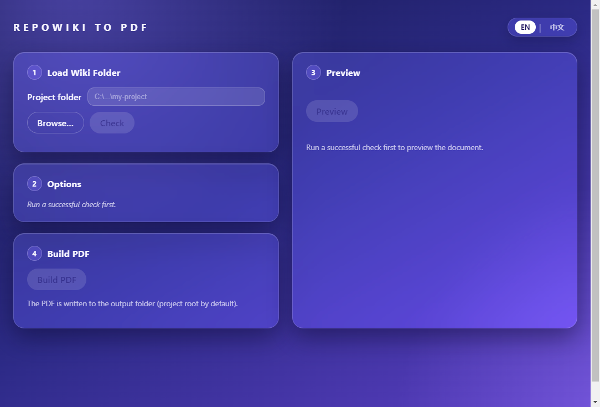
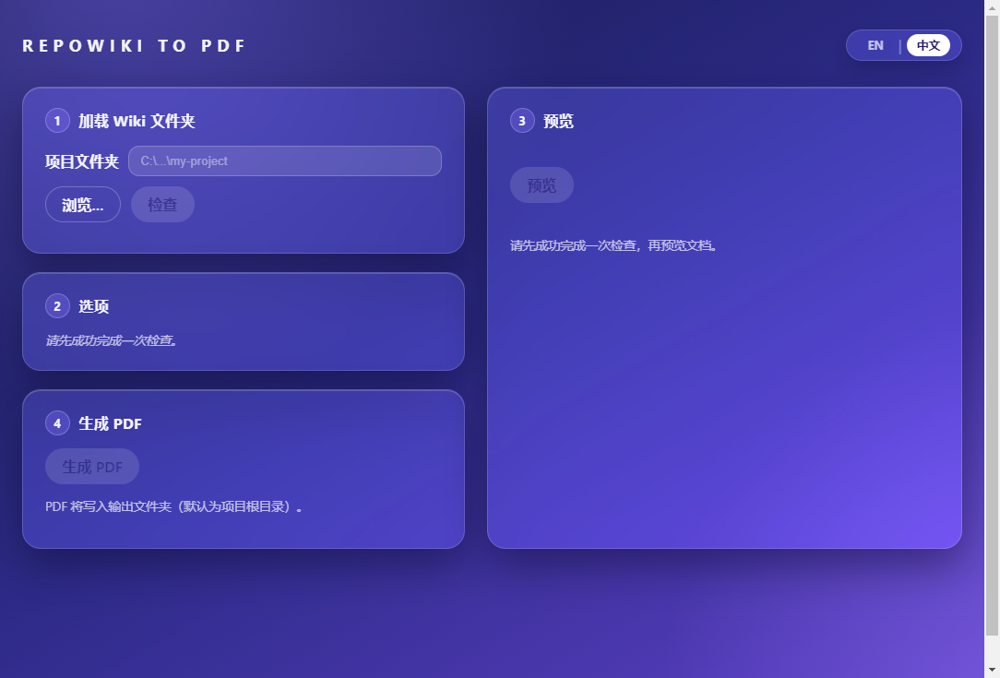

# REPOWIKI TO PDF

**Qoder generates a beautiful Repo Wiki — then locks it inside the IDE. REPOWIKI TO PDF turns it into a single, vector, print-ready document your clients can actually receive.**


<!-- DEMO:GIF
──────────────────────────────────────────────────────────────────────────────
Demo slot. When the GIF is ready:
  1. Record the full flow in the app — Load Wiki Folder → Check → Options →
     Build PDF → Open The File (OBS Studio or Win+G; ~1280×800, under 10 MB).
  2. Save it as assets/demo.gif and commit.
  3. Replace the screenshot table below with:
       
Until then the committed screenshots serve as the fallback demo.
────────────────────────────────────────────────────────────────────────────── -->

<table>
  <tr>
    <td align="center"><strong>English</strong></td>
    <td align="center"><strong>中文</strong></td>
  </tr>
  <tr>
    <td></td>
    <td></td>
  </tr>
</table>

## Why

- **Vector, not screenshots.** Selectable, searchable text and crisp SVG diagrams at any zoom — a PDF your client can actually read, not a printout of pixels.
- **One file, not a folder of Markdown.** The whole wiki — cover, contents, every page — typeset into a single document you can attach to an email or deliver to a client.
- **Bookmarks and links survive.** Native PDF outline, clickable table of contents, working internal cross-links — everything Qoder shows you in the IDE still works on paper.
- **Print-ready.** A4 or Letter, per-section page breaks, footer page numbers and staple-safe margins, ready for the printer or the client's inbox.

## Features

- **Vector text, never screenshots.** Selectable, searchable text with GitHub-style typography — headings, tables, lists, blockquotes and syntax-highlighted code.
- **Mermaid diagrams as inline SVG** — rendered offline with **Mermaid v12**, the same major Qoder uses, plus an auto-repair pass for the non-standard dialect Qoder tolerates. Broken diagrams degrade to a visible fallback instead of aborting the build.
- **Native PDF bookmarks** — a hierarchical outline mirroring the wiki tree, so readers can jump from the sidebar of any PDF viewer.
- **Clickable TOC + working internal links** — wiki-to-wiki links become in-document anchors; heading fragments resolve to the right section; external links stay clickable URIs.
- **Print-ready A4 / Letter** — per-section page breaks, cover page toggle, footer page numbers and gutter margins that keep content clear of the staple edge.
- **Two TOC sources** — the hierarchy is read from `wiki_plan.yaml` when present, and from Qoder's newer `repowiki-metadata.json` + the `content/` tree when it isn't; file order is the last resort. Every fallback is reported, never silent.
- **EN / 中文 app UI** — one click to switch, remembered between runs; documentation and About built in.
- **Offline and private.** No telemetry, no network calls, nothing leaves your machine. Your wiki is your business.

## Quick start (from source)

**Prerequisites:** Windows 10/11 x64, [Node.js](https://nodejs.org/) ≥ 20 and npm (workspaces). End users need nothing — just the installer.

```bash
npm install                                  # core + theme + app workspaces

npm run dev   -w @repowiki-pdf/app           # Vite renderer + Electron, hot reload
npm run start -w @repowiki-pdf/app           # build Electron main, run it directly

npm test                                     # core unit tests (Vitest)
npm run typecheck                            # tsc across the monorepo
npm run lint                                 # Biome

npm run test:window    -w @repowiki-pdf/app  # real-window smoke gate
npm run test:integration -w @repowiki-pdf/app # fixture → PDF structural assertions

npm run dist -w @repowiki-pdf/app            # electron-builder → release/ (NSIS + portable)
```

> Installers are not published in the repo tree (GitHub file-size limits): grab `repowiki-to-pdf Setup 0.1.9.exe` / `repowiki-to-pdf Portable 0.1.9.exe` from the GitHub Releases page.

## How to use

1. **Load Wiki Folder** — pick the project root that contains `.qoder/repowiki` (generate the wiki in Qoder first, then commit or pull it).
2. **Check** — the app scans the wiki, lists languages and page counts, and unlocks the next steps.
3. **Options** — page size (A4 / Letter), cover on/off, language, output folder (blank = project root).
4. **Build PDF** — progress advances page by page; a live WYSIWYG preview sits beside the controls.
5. **Open / Print** — a report shows the output path, page count and warnings, with one-click **Open The File** and **Print**. The document is written to `<Project>-Documentation.pdf`.

## Warning codes

The build never fails on a single local problem — it degrades gracefully and tells you exactly what happened:

| Code | Meaning |
|------|---------|
| `PLAN_MISSING` | No `wiki_plan.yaml` — pages were ordered alphabetically. |
| `PLAN_METADATA_USED` | `wiki_plan.yaml` was missing, so titles and numbering were inferred from the wiki metadata files. |
| `PLAN_TITLE_UNMATCHED` | A table-of-contents entry in the plan matches no page title. |
| `PAGE_NOT_IN_PLAN` | A wiki page exists but is not listed in the plan. |
| `MERMAID_INVALID` | A diagram could not be parsed even after the repair pass — a placeholder was rendered. |
| `MERMAID_REPAIRED` | Non-standard Qoder diagram syntax was auto-corrected before rendering (normal, informational). |
| `BROKEN_LINK` | A Markdown link points to a file that does not exist in the wiki. |
| `IMAGE_MISSING` | A referenced image file was not found. |
| `LINK_FRAG_DROPPED` | A link's `#fragment` could not be mapped to a specific page; the link still points to that page. |
| `SECTION_MARK_MISSING` | An expected section anchor was not found while building bookmarks or internal links. |

## Limitations

- **No automatic landscape pages.** Very wide diagrams scale to fit the portrait width; the landscape hook exists in the print CSS but is dormant (decision recorded internally — Architecture Decision Records available on request).
- **EXE file icon is the Electron default.** The signing/rcedit step is skipped in our build environment, so the binary itself keeps stock branding; window, taskbar and installer icons are custom.
- **Core-produced messages remain in French** (errors, phase labels, warning detail text). The app UI — including Documentation and About — is fully EN/中文; warning *codes* are technical and always verbatim.
- One language per export; GUI-only (no CLI); folder input is picker or paste, not drag-and-drop.

## Architecture

A small TypeScript monorepo: a pure **core** (no Electron), a **theme** package, and the Electron **app** (main / preload / renderer). Full pipeline and IPC contract: [ARCHITECTURE.md](ARCHITECTURE.md). Architectural decisions are recorded as Architecture Decision Records, available on request.

## Roadmap

The roadmap is public. See the pinned **Roadmap issue** in [GitHub Issues](https://github.com/Linxellstechnology/repowiki_to-pdf/issues) — feedback and `good first issue` picks are welcome.

## Credits

Developed by **Hello Dati** — [contact@hellodati.com](mailto:contact@hellodati.com) — By **Nizar HAMDI**.

## License

MIT — see [LICENSE](LICENSE).

---

⭐ If this saves your team a broken PDF, a star helps others find it.
